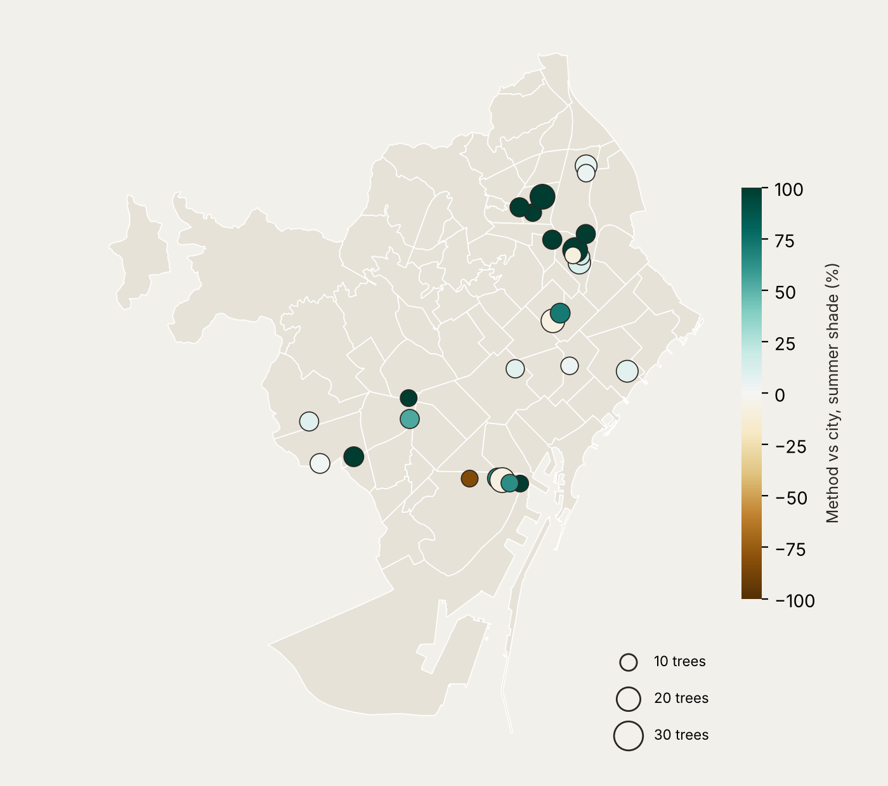
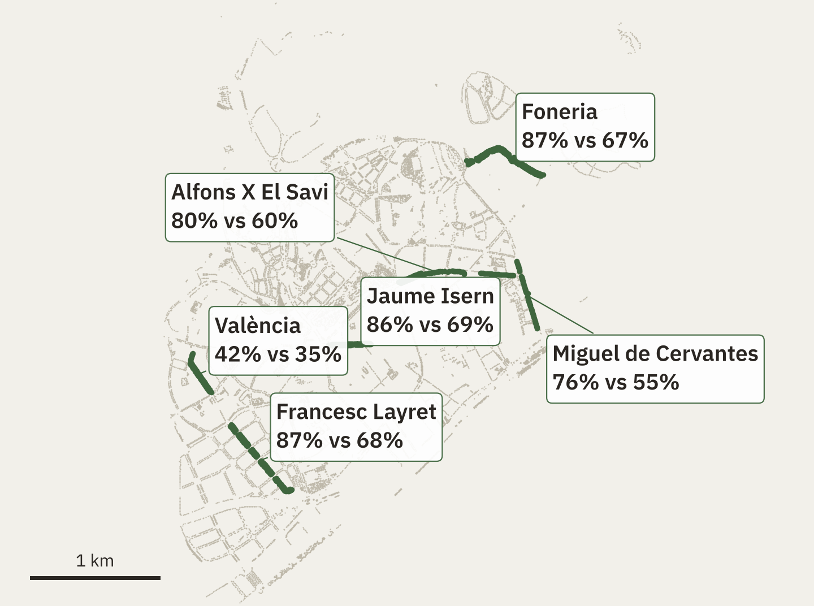

# Validation {#sec:validation}

<!-- Draft 1, 26 Nov 2026. All numbers from thesis/results_numbers.md (§5, §7, §9, §11), after the needle-tree fix (PR #184).
Sources behind the sheet: notes/methodology.md §4b, §5, §5b; notes/method_heat_validation.md §6;
notes/decisions/runoff_metric_sensitivity.md §8, §10; study/guide.md (routing vs RESCCUE);
scripts/backtest_works.py (docstring) and databases/barcelona/backtest_works_guide.csv; notes/mataro_transfer_test.md.
Feedback integrated: notes/tutor_feedback_24nov.md (W1 critical review, P1 readable units, P2 results in space). -->

A method that chooses trees has to be checked in two ways:

- **Its parts:** do the models inside it measure what they claim to measure?
- **The method as a whole:** does it choose better than the people who choose today?

This chapter answers both. It describes what each part was checked against, and how far each check goes. It then tests the method on what Barcelona really planted, and in a second city. The results for Porta follow in Chapter 7.

## Validation strategy {#sec:val-strategy}

No field data exist that would measure a layout before it is planted. Validation therefore rests on four kinds of evidence, each matched to one part of the method (@tbl:val-strategy):

- **Calibration:** a parameter fitted on open field measurements;
- **Cross-model checks:** the fast models inside the optimiser compared with slower, more complete ones;
- **Resolution:** the smallest difference the model can tell apart, so that smaller differences are not read as results;
- **Back-testing:** the method given the same choice the city faced, at the same positions, and compared with what the city did.

| Part of the method | Checked against | Kind of check | Section |
|---|---|---|---|
| Rain held by a crown | Field interception data from Freiburg | Calibration | [Interception](#sec:val-interception) |
| Heat proxy (shade) | Ladybug UTCI, Tier 1 and Tier 2 | Cross-model | [Heat proxy](#sec:val-heat) |
| Flood hotspots from flow routing | RESCCUE flood model maps | Cross-model | [Routing](#sec:val-routing) |
| Runoff differences | Error of the calibration | Resolution | [Resolution](#sec:val-resolution) |
| The whole method | What the city planted, 26 groups | Back-test | [Back-test](#sec:val-backtest) |
| The whole method elsewhere | Mataró's streets and its practice | Transfer test | [Transfer](#sec:val-transfer) |

: What each part of the method is validated against. {#tbl:val-strategy}

{#fig:val-strategy}

The back-test is the main validation. It is the only check that compares the method with real decisions, made by the city, in real streets. The other checks say how far each number can be trusted.

## Interception: calibration on field data {#sec:val-interception}

The runoff model stores rain on each crown up to a depth of s · LAI (Chapter 5). The parameter s was fitted on open field data from Freiburg [@anys2024]:

- 16 urban trees, small-leaved lime and Norway maple;
- April to September 2021, leaf-on;
- 51 events of at least 1 mm.

The pooled median is **s = 1.75 mm per unit of LAI** (lime 1.85, maple 1.60). Per event, the error of the fitted model is 0.9–3.2 mm (RMSE, from the best to the worst tree).

**Is 1.75 mm plausible?** At an LAI of 2.3, a crown then holds about 4 mm. That is within the first 2–4 mm of a storm that leafy crowns are reported to hold [@kuehler2017]. The fitted value includes the evaporation during an event. For Barcelona's short, intense storms the true value may be lower. Two lower values were therefore tested:

- 0.86 mm, the surface storage measured in a rainfall simulator [@xiao2016];
- 0.83 mm per unit LAI, for *Quercus ilex* [@hassan2017].

With either, every difference between layouts shrinks roughly in proportion to s, and keeps its sign. The ranking of layouts does not change, and every difference stays below 1% of Porta's runoff.

**Limit.** The calibration trees are two temperate species in Germany, not Mediterranean street trees. No open interception data for a Barcelona street tree were found. The same s is used for all species (`ASSUMPTION`). A test with one storage factor per species did not change the ranking either.

## Heat proxy against Ladybug {#sec:val-heat}

The optimiser cannot run a UTCI simulation for each of thousands of layouts. It uses a shade proxy instead: effective shade on sunlit open ground, with crown opacity from LAI (Chapter 5). The proxy is only useful if it moves the way felt temperature moves.

**The check.** On one street, Passeig d'Andreu Nin, the proxy was compared with Ladybug's UTCI at the same 1,974 points, the same hours (12–17 h) and the same crowns (Tier 1):

- **Across points,** in today's layout, more proxy shade means lower UTCI: **r = −0.73**.
- **On the change between layouts** (optimised minus today), **r = −0.82** with opaque crowns, and −0.76 with LAI opacity.
- **The slope** is about −0.5 °C of UTCI per hour of full shade.

So the proxy ranks points and layout changes the way Ladybug does. Its correlation is close to the rank agreement of a published UTCI surrogate (Kendall 0.84) [@tanliu2026]. A different measure, though, so the two numbers are not directly comparable.

**A second chain.** The Ladybug chain was rebuilt in Python, so that crowns could pass light through τ = exp(−0.5 · LAI), as proposed by @peng2026. Against the Grasshopper run, the Python chain has a bias of −0.01 °C and r = 0.999 over 4,271 points in Porta. It reproduces Ladybug, and it can be run on all of Porta without opening Rhino.

**All of Porta.** Over the 21,352 points of Porta's plane streets, the optimised layout differs from today by −0.04 °C of UTCI with opaque crowns and −0.11 °C with porous crowns. A Honeybee run with porous crowns on Passeig d'Andreu Nin (Tier 2) gives −0.15 °C. Per point, the change ranges over about ±1 °C.

**What this allows us to say.** The method's heat claim is about **shade**, not degrees:

- The proxy ranks points and layout changes as the simulation does. That supports a ranking, not a claim in degrees: on Passeig d'Andreu Nin, with opaque crowns, the optimised layout was 0.12 °C warmer than today, and the sign of the change flips between opaque and porous crowns. The defensible statement is "no worse within model uncertainty", not "cooler".
- The difference between layouts, averaged over a district, is a tenth of a degree. That is within the error of Ladybug against ENVI-met (UTCI bias 0.8–2.3 °C) [@mannucci2025].
- Ladybug treats trees as shade only. The cooling from transpiration is missing from both tools [@mannucci2025].

The thesis therefore reports summer shade as the heat result, and says "cooler" only where the simulation shows it.

**TO UPDATE.** The UTCI runs above used the earlier, seven-species layouts from before the crown fix of 26 November. The runs on the final layouts, and the Infrared City check, are still to come.

## Flood hotspots: routing against RESCCUE {#sec:val-routing}

The runoff objective counts water at flood hotspots. The method finds where water converges by routing it over the terrain model (Chapter 5). Barcelona's RESCCUE project mapped where the drainage system floods in a design storm. The two were compared over Porta's open ground:

- **Overall,** upstream area barely separates wet from dry cells: ROC AUC 0.52, close to chance.
- **At the top,** the top 0.5% of open ground by upstream area is wet in 58–80% of cases. That is 1.7–2.6 times what chance would give.

The routing finds the main points where water converges. It is not a flood map. A likely reason, not yet tested, is that the sewer network, which RESCCUE models and the routing does not, decides much of where water ends up. The hotspots used in the objective therefore stay tied to the city's Resilience Atlas index, and the routing only says which trees drain towards them.

## What the runoff model can resolve {#sec:val-resolution}

A difference in runoff means something only if it is larger than the error of the model that computes it. The calibration's event RMSE gives that error:

- 1 mm of interception error over today's street crowns in Porta (10.4 ha) is 104 m³ of water held;
- at the T2-60 design storm, that becomes 102 m³ of runoff;
- the smallest RMSE in the calibration, 0.89 mm, therefore corresponds to **Δmin = 91 m³** of runoff over Porta.

This is about 0.5% of Porta's runoff in the design storm. It treats the error as the same for all trees (`ASSUMPTION`); independent errors would partly cancel, but the calibration cannot tell which case holds.

**Consequence.** Δmin is a difference in Porta's total runoff. Every total-runoff difference between layouts in Porta is below it (Chapter 7). Hotspot runoff is reported, but not tested against Δmin, because Δmin was not derived at that scale; nor is it applied to other barris. Runoff is therefore used as a **do-no-harm check**: a layout passes if it is not worse than city practice. It is never claimed as a gain.

## Back-test: what the city really planted {#sec:val-backtest}

The strongest test of a method that advises a decision is to give it a decision that was already taken, and compare. Barcelona's quarterly tree inventory makes that possible. It records, position by position, when a species changed between 2018 and 2026.

**The groups.** A group is a place where the city replaced many trees at once:

- at least 10 trees changed species in the same quarter, within 25 m of each other;
- at least half of the new trees are in the smallest trunk class, so that they look like a real planting and not a re-coding of the inventory;
- the barri has LiDAR tree crowns.

This gives **26 groups and 366 positions** across Barcelona (@fig:backtest-map). Street works were found in city notices or the press for some of them: on Carrer de Piquer, the works and the tree change are both confirmed. The others are probably replacement campaigns. In every case, the inventory records what the city actually planted.

{#fig:backtest-map}

**The test.** In each group, every other tree is kept as measured. The same positions are then given three answers:

- **before:** the species the city removed;
- **city:** the species it planted;
- **method:** the species the method chooses, with the balanced weights and the city's rules (the 15% cap, the 2011 guide's sizing rule, and the Barcelona palette).

All species are compared at the same trunk size (`ASSUMPTION`). The comparison is therefore between species, not between young trees and old ones. Shade is scored within 40 m of the positions (`ASSUMPTION`), which holds every summer shadow in the 12–17 h window.

**Result.** The method gives more summer shade than the city's choice in **23 of the 26 groups** (@tbl:backtest).

| Measure | City | Method |
|---|---|---|
| Groups with more summer shade (gain > 1%) | — | 23 of 26 |
| Summer shade per new tree, median (m²·h) | 76 | 130 |
| The same as average shaded area per tree (m²) | 12.6 | 21.6 |
| All 366 positions together | — | +45% |
| Groups with more runoff at the flood hotspots | — | 0 of 26 |
| Groups with less winter shade (more winter sun) | — | 14 of 26 |

: Back-test on 26 groups the city replaced between 2018 and 2026, same positions, same trunk size. Average shaded area = m²·h over the six hourly sun positions from 12:00 to 17:00, divided by six. {#tbl:backtest}

Read as an area: each new tree chosen by the city shades, on average over a summer afternoon, about 13 m² of open ground. The same tree chosen by the method shades about 22 m². That is **1.7 times** as much, for the same works and the same cost (Chapter 7).

**Where the method loses.** Three groups go the other way:

- In el Poble-sec, ten positions on a narrow street, where the city planted *Tecoma stans* and the method *Hibiscus syriacus*: −60%. Only small species fit, and both choices give little shade.
- In el Camp de l'Arpa del Clot (20 positions) and el Parc i la Llacuna del Poblenou (11), by 9% and 3%. These are small margins.

The three losses have different causes:

- **el Poble-sec (narrow sidewalks):** seven of the ten positions are "small" sidewalks. Where the sidewalk allows only small trees, the palette offers little, and the city's choice can be as good or better.
- **el Camp de l'Arpa del Clot (unmeasured positions):** all 20 positions lack a façade-bounded sidewalk width, so only the façade test applies to the method.
- **el Parc i la Llacuna del Poblenou (rule asymmetry):** the city planted large *Gleditsia* on medium sidewalks. The city's choice is not held to the sizing rule, while the method's is. The largest wins are where large species fit. In Sant Andreu, the city planted *Fraxinus ornus* where the method chooses *Celtis australis*, and the method gives more than six times the shade per tree.

**Does it depend on how the rules are read?** The test was run under three readings of the sizing rules (@tbl:backtest-rules).

| Reading of the rules | Groups won | Median per tree, city → method (m²·h) | All positions |
|---|---|---|---|
| 2011 guide sizing (headline) | 23 of 26 | 76 → 130 | +45% |
| Guide sizing, small species held to the guide's adult size | 20 of 26 | 76 → 129 | +44% |
| Façade test only (crown radius ≤ distance to façade) | 15 of 26 | 76 → 110 | +36% |

: Back-test under three readings of the sizing rules. {#tbl:backtest-rules}

The façade-only reading is stricter than the city's own practice. On narrow streets with balconies it leaves only the smallest species. Under all three readings the method wins most groups, and its overall margin stays between +36% and +45%.

**Limits of the back-test.**

- All trees are compared at the same trunk size. The test compares species, not the years a young tree needs to grow.
- The city's choice is not held to the sizing rule or to façade clearance; the method's is. This favours the city, which makes the comparison conservative.
- Trees removed without replacement, or added at new spots, are not in the test.
- The groups were selected by rule, not at random. They represent group replacements, not the one-by-one replacements that make up most of the city's work.

## Transfer test: Mataró {#sec:val-transfer}

A method built in one district could fit that district alone. The transfer test asks whether it travels. Mataró, a coastal Catalan city, was chosen because it publishes a full design storm and its tree inventory could be obtained, and because its LiDAR comes from the same regional survey as Barcelona's.

**What was tested.** A forward what-if, not a back-test. Mataró has one inventory snapshot, so no replacement can be replayed. Instead, on Mataró's six streets with the most plane trees, every plane was replaced by:

- **the method:** the same core as in Barcelona, with the 30-species palette, the 15% cap, façade clearance and the balanced weights;
- **S1a and S1b:** Barcelona's announced mix and Barcelona's city practice;
- **S1m, Mataró's own practice:** the species mix of its smallest trees (girth below 30 cm, about 3,400 trees), read as recent plantings (`ASSUMPTION`);
- **a random palette.**

Each practice and the random palette were drawn five times.

**Result.** The method keeps a median of **83%** of the planes' summer shade, against **63%** for Barcelona's city practice (S1b) and 50% for Mataró's own recent plantings (@tbl:mataro). It wins on **all six streets**.

| Median of 6 streets | Method | S1a | S1b | S1m (Mataró) | Random |
|---|---|---|---|---|---|
| Summer shade, % of the planes' | 83 | 61 | 63 | 50 | 49 |

: Mataró transfer test: summer shade of the new trees as a share of the planes' shade, at the same trunk size. {#tbl:mataro}

{#fig:mataro-map}

- **Runoff:** the method is never worse than any practice (6 of 6). It is 0.3–1.2% above today's planes, as every practice is.
- **Winter shade:** the method casts less winter shade than S1b on all six streets.
- **The weak case** is València, a narrow street: 57% of its positions fit no palette species that clears the façades. There the method reaches 42% against 35% for Barcelona's city practice.

**Approximations.** This first run carries six approximations, which must be stated whenever it is shown:

1. **Crowns.** No Mataró LiDAR was processed yet, so every tree takes the median crown of its species in Barcelona. The method is not limited by this, because its palette has the same crowns in both cities.
2. **Buildings** come from Overture Maps. Where no height is given, 9 m is assumed. The ground is taken as flat.
3. **Runoff.** No Mataró pluvial hazard map exists, so runoff counts all open ground. Barcelona's T2-60 storm is used only to rank layouts.
4. **Sidewalk sizing.** Mataró's sidewalk widths are not measured, so only façade clearance applies, to the method and to the practices alike.
5. **The 15% cap is per barri.** It is the method's rule; Mataró has no such rule.
6. **Mataró's practice (S1m)** is inferred from trunk girth, not from planting dates.

**Diversity.** The diversity floor was not used. Where the cap does not bind, one species dominates, as in Barcelona. The species choices must not be shown before a rerun with the floor.

**TO UPDATE.** Two things are missing:

- the rerun with Mataró's own LiDAR crowns (ICGC flight of 20 July 2021) and the diversity floor;
- the full transfer test in Florence, which uses the city's 2023 LiDAR and was confirmed as a full test, not a lighter check, at the review of 24 November.

## What the validation supports {#sec:val-summary}

| Claim | Evidence | Verdict |
|---|---|---|
| The method chooses species that give more summer shade than the city's choice | Back-test 23 of 26; Mataró 6 of 6 | Supported, at equal trunk size |
| The proxy ranks points and layout changes as UTCI does | Proxy vs Ladybug r = −0.73 (points), −0.82 (change) | Supported for ranking; °C differences are within model error and can change sign |
| The method does not increase runoff against city practice | Back-test 0 of 26 worse; Mataró 6 of 6 not worse | Supported as do-no-harm |
| The method reduces runoff | All total-runoff differences in Porta below Δmin = 91 m³ | Not resolved |
| The method transfers to another city | Mataró, approximate crowns | Partly supported; Florence pending |

: What the validation supports, and how strongly. {#tbl:val-summary}

<!--
FIGURES TO PRODUCE (ch. 6)
- fig/ch6_validation_strategy.png  flowchart: module → check → section (from @tbl:val-strategy); rendered image, not native shapes (Giovanni's slide rule).
- fig/ch6_backtest_map.png  Barcelona map, 26 group centroids (backtest_works_guide.csv x,y), dot size = n, colour = gain % method vs city (clip ±100), barri boundaries. Existing deck map in scripts/make_backtest_deck.py can be reused.
- optional: per-group bar pairs (city vs method m²·h per tree), as in the back-test deck slide "Summer shade per new tree".
- optional: one localised group (Av. Rio de Janeiro or Piquer) before / city / method, aerial + crowns (tutor P2–P3; Street View stays private).

PROVISIONAL CITATION KEYS (new in this chapter; others as in chapters 2–5)
hassan2017     #8   Hassan, Ghimire & Lubczynski 2017, J. Hydrol. 555:489–505
tanliu2026     #80  Tan & Liu 2026, Sustain. Cities Soc. 149:107726 (already used in ch. 4)
Already in ch. 2–5: anys2024, kuehler2017, xiao2016, peng2026, mannucci2025.
Data credits in prose (Appendix B): Open Data BCN arbrat viari (quarterly, 2018–2026); ICGC LiDAR 2021; RESCCUE; Ajuntament de Mataró tree inventory (Llicència oberta d'ús d'informació – Catalunya); Overture Maps (ODbL); Comune di Firenze LiDAR 2023.
Mataró choice: notes/catalan_transfer_city.md §5b (design storm), §3b (tree data); ICGC LiDAR flight 20 Jul 2021 (mataro_transfer_test.md).
-->
