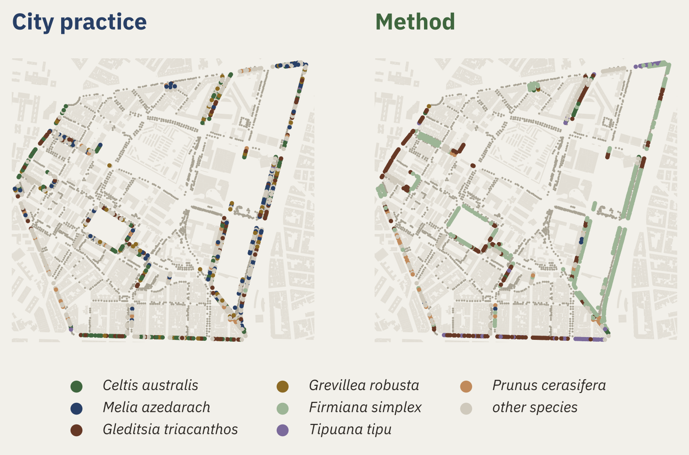
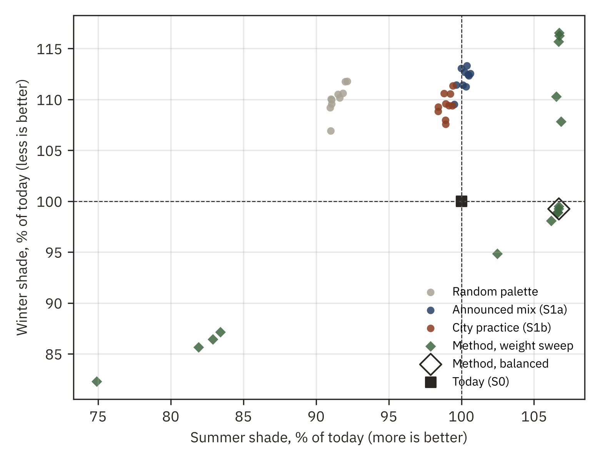
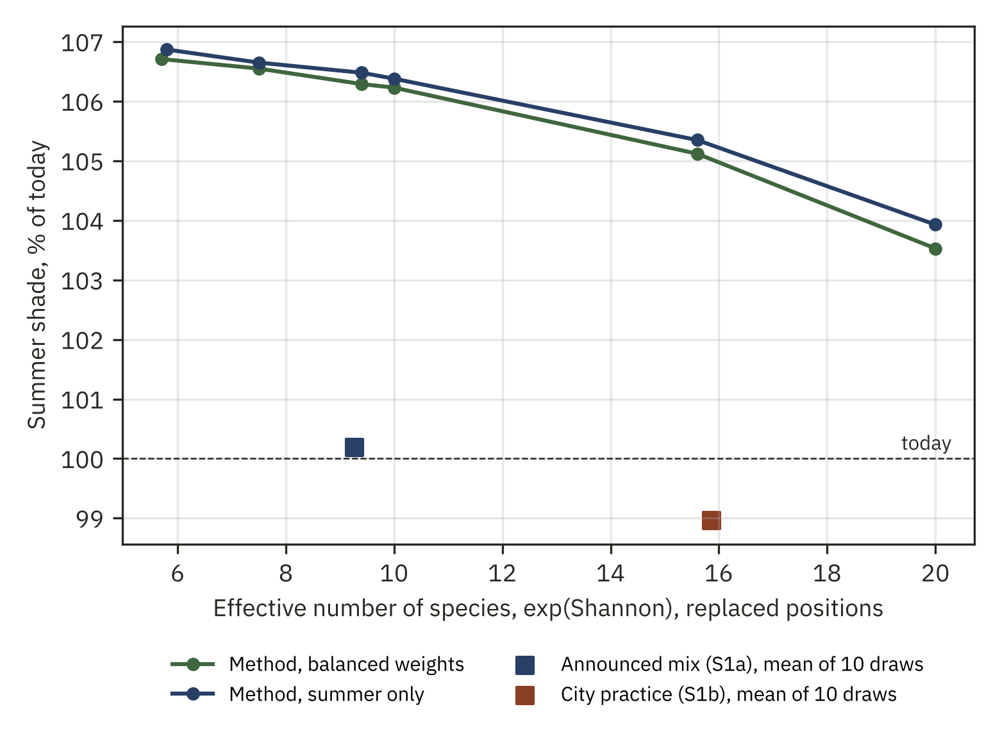
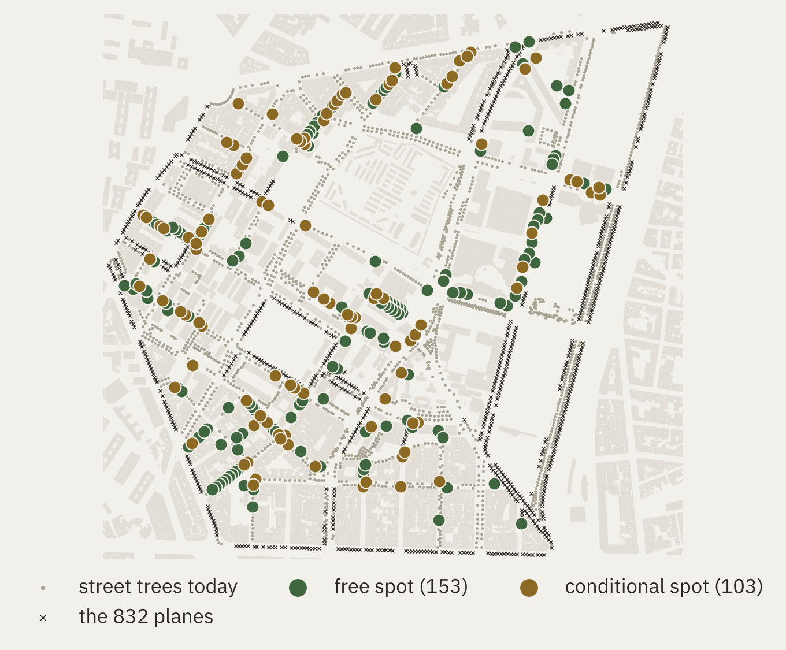

# Results {#sec:results}

<!-- Draft 2, 26 Nov 2026 (replaces the 23 Nov headline draft). All numbers from thesis/results_numbers.md,
recomputed after the needle-tree fix (PR #184). Sections marked TO UPDATE wait for runs that are not finished:
the 30-species barri runs after the fix, the additions (A, R+A) on the 30-species palette, the gain decomposition
(notes/tutor_feedback_24nov.md §3b), cost per layout (§3c), and UTCI on the final layouts.
Feedback integrated (notes/tutor_feedback_24nov.md): readable units (P1, D5), results placed on maps (P2, W2),
why the method works (R2), where it loses (§3g.2), what it changes (W3, §3h). -->

This chapter reports what the method does in Porta and beyond. It follows the scenarios of Chapter 5:

- **R:** the 832 plane positions are replaced, by city practice or by the method;
- **S1c:** the city's own per-tree plan for 513 of those planes;
- **A and R+A:** new trees in free sidewalk spots;
- **the city:** the same comparison in 32 barris.

**Units.** Summer shade is reported as a share of today's (S0), on the hot-afternoon window, 12–17 h. Where an area helps, it is also given as the **average shaded area**: the open ground that the crowns shade, on average, over that afternoon (the sum over six hourly sun positions, divided by six). Runoff is in cubic metres at the flood hotspots, for the T2-60 design storm. Unless stated otherwise, "the method" is the balanced layout (weights: summer 0.50, winter 0.25, runoff 0.25), and "city practice" is S1b, the mix the city really planted where planes were replaced in 2018–2026.

## Porta: replacing the plane trees {#sec:res-porta}

@tbl:porta-r compares the method with today and with the city's two baselines.

| Scenario | Summer shade, % of today | Average shaded area (m²) | Winter shade, % of today | Runoff at hotspots (m³) | Effective species |
|---|---|---|---|---|---|
| S0 today | 100 | 60,020 | 100 | 2,702.8 | (planes) |
| S1a announced mix | 100.2 | 60,133 | 112.0 | 2,703.3 | 9.3 |
| **S1b city practice** | **99.0** | **59,397** | **109.4** | **2,704.7** | **15.9** |
| S1 random palette | 91.4 | 54,882 | 110.0 | 2,709.6 | 28.6 |
| **Method (balanced)** | **106.7** | **64,046** | **99.2** | **2,698.8** | 5.7 |

: Porta, the 832 plane positions replaced. Barcelona palette (30 species), exact sizing rule, all species at the same trunk size class (trunk class TERCERA where the city has enough trees of the species, else SEGONA (9 of the 30 species)). S1a, S1b and random are means of 10 draws. {#tbl:porta-r}

**Summer.** City practice keeps about today's shade (99.0%). The method gives **106.7%**, 7.7 points more. As an area, the method shades about **4,600 m² more** open ground than city practice on an average summer afternoon, and about 4,000 m² more than today's planes.

**Winter.** In winter, shade is a cost, because it takes sun from people who want it. City practice casts 9% more winter shade than today's planes. The method casts slightly less than today (99.2%). The method therefore gives more summer shade **and** more winter sun than city practice.

**Runoff.** The method sends 2,698.8 m³ to the hotspots, against 2,704.7 m³ for city practice and 2,702.8 m³ today. Total runoff over Porta is 17,641.1 m³ with the method against 17,661.0 m³ with city practice, a difference of 19.9 m³. That is well below Δmin = 91 m³, the smallest total-runoff difference the model can resolve (Chapter 6). The result is read as **equal**: the method does no harm to runoff. Hotspot runoff is reported because it shows where the water goes, but it is not tested against Δmin, which was derived for Porta's total runoff.

**Chance.** A random choice from the same palette, under the same rules, gives 91.4%. Choosing species well is worth about 15 points of summer shade over choosing them at random. City practice already captures about half of that gain.

{#fig:porta-gain-map}

@fig:porta-gain-map places the two layouts on the map. **TO UPDATE:** a map of the summer shade gain per street, from the final run.

### The trade-off between the objectives {#sec:res-tradeoff}

The weight sweep produces 15 layouts, from summer shade only to runoff only. Four of them show the shape of the trade-off (@tbl:porta-sweep).

| Layout (weights summer / winter / runoff) | Summer % | Winter % | Runoff at hotspots (m³) |
|---|---|---|---|
| Summer only (1 / 0 / 0) | 106.9 | 107.8 | 2,698.9 |
| **Balanced (0.50 / 0.25 / 0.25)** | **106.7** | **99.2** | **2,698.8** |
| Runoff only (0 / 0 / 1) | 106.5 | 110.3 | 2,698.1 |
| Winter sun only (0 / 1 / 0) | 74.9 | 82.3 | 2,720.0 |

: Porta, four layouts of the weight sweep. {#tbl:porta-sweep}

Three readings follow.

- **Summer shade and runoff agree.** The summer-only and runoff-only layouts are almost the same in both. Both reward large, dense crowns.
- **Winter sun is cheap to add.** Moving a quarter of the weight from summer shade to winter sun (0.75 / 0.25 / 0) costs 0.15 points of summer shade and removes 8.3 points of winter shade. The balanced layout takes this almost-free gain.
- **Winter sun alone is a different design.** Optimised only for winter sun, the layout gives up a quarter of the summer shade. No designer would choose it, but it marks the edge of the trade-off.

{#fig:porta-tradeoff}

## Why the method works {#sec:res-why}

The method and city practice fill the same positions, under the same rules. The difference lies in **which species goes where**.

**Different species.** The balanced layout plants mostly *Firmiana simplex* (423 trees, 51%), then *Gleditsia triacanthos* (176) and *Tipuana tipu* (48). City practice plants mostly *Celtis australis* (127), *Melia azedarach* (112), *Gleditsia* (84) and *Grevillea robusta* (64).

**What the data show about those species** (@tbl:why-species):

- *Firmiana* is a medium-sized species with a dense crown. At equal trunk size its LAI proxy, 3.22, is the highest of the twelve medium species in the palette. Its crown, 7.55 m, ranks fifth of the twelve; *Melia* (8.14 m), *Quercus ilex*, *Styphnolobium* and *Cercis* are wider. On medium sidewalks, where the rules exclude large species, it is the densest shade available.
- It is winter-deciduous, so it shades in summer and lets the sun through in winter.
- The method uses *Firmiana* up to its limit under the 15% cap (423 trees). The cap, not the method, stops it there.
- *Celtis australis*, the city's most planted replacement, has a larger and denser crown still. Its headroom under the cap, though, is only 127 trees. The cap is read within Porta (Chapter 5): 15% of Porta's 2,825 trees is 423 per species, and Porta already has 296 Celtis. Both baselines are held to that limit.
- *Grevillea*, which city practice plants, is evergreen. It adds winter shade.

| Species | Crown diameter (m) | LAI proxy | Size class | Leaf habit | Method | City practice |
|---|---|---|---|---|---|---|
| *Firmiana simplex* | 7.55 | 3.22 | medium | winter-deciduous | 423 | 2 |
| *Gleditsia triacanthos* | 8.87 | 2.58 | large | winter-deciduous | 176 | 84 |
| *Celtis australis* | 8.20 | 3.59 | large | winter-deciduous | 16 | 127 |
| *Melia azedarach* | 8.14 | 2.98 | medium | winter-deciduous | 4 | 112 |
| *Grevillea robusta* | 8.21 | 2.98 | large | evergreen | 2 | 64 |
| *Platanus × acerifolia* (today) | 8.69 | 2.81 | large | winter-deciduous | — | — |

: The species behind the result, at equal trunk size (trunk class TERCERA where the city has enough trees of the species, else SEGONA (9 of the 30 species)), and how many of each the method and city practice plant in Porta. City practice counts are means of 10 draws, rounded. {#tbl:why-species}

**A wider palette.** The city's narrow list of seven species gives the method 99.3% in Porta, and the full 30-species palette 106.7%. City practice on the narrow list keeps 93.8%. The method gains over practice with either palette. The palette difference on the method, 7.4 points (106.7 against 99.3), is at most the share of the 7.7-point margin over practice that the wider palette explains. It is an upper bound, not a decomposition. **TO UPDATE** with the gain decomposition.

**TO UPDATE: the gain decomposition.** The full split of the gain into placement (the same species as practice, placed optimally), species choice (the method on the city's seven species) and palette width (the full method) is being run on Porta and the back-test groups. It will replace the qualitative reading above with one stacked bar.

## The city's own plan (S1c) {#sec:res-s1c}

In November 2026 Parcs i Jardins shared its per-tree replacement plan for Porta. It names a new species for 513 of the 832 planes. That plan is the most direct baseline there is: what the city intends to plant, tree by tree.

| Scenario | Summer % | Winter % | Runoff at hotspots (m³) | Effective species |
|---|---|---|---|---|
| S0 today | 100 | 100 | 2,702.8 | — |
| S1c city plan | 98.2 | 104.4 | 2,699.8 | 9.7 |
| Method, no diversity floor | 101.4 | 97.7 | 2,699.5 | 5.7 |
| **Method, same diversity as the plan (9.7)** | **101.4** | **98.1** | **2,699.6** | **9.7** |
| Method, diversity 14.3 | 100.9 | 98.2 | 2,699.7 | 14.3 |

: The city's per-tree plan for 513 of Porta's planes against the method on the same positions. The other planes are kept. Credit: Parcs i Jardins de Barcelona, Institut Municipal. {#tbl:s1c}

- The plan keeps the shade close to today, at 98.2%.
- At the **same diversity** as the plan, the method gives 101.4%, **3.2 points more**. It turns a small loss into a small gain.
- The method casts less winter shade (98% vs 104%).
- Runoff is equal (2,699.6 vs 2,699.8 m³).

The margin is smaller than against city practice in @tbl:porta-r, mainly because only 513 positions change, not 832. On the same 513 positions, city practice gives 98.3%, about the same as the plan. The plan itself is not published here; only the totals are.

## Diversity {#sec:res-diversity}

Without a constraint, the method concentrates on the species that give the most shade. In Porta it reaches 5.7 effective species, against 15.9 for city practice. Here diversity is the effective number of species, the exponential of Shannon's index, as used by SylvCiT [@nicol2026]. The 15% cap alone does not prevent this. In the Porta run the cap is read within Porta (Chapter 5): 15% of Porta's 2,825 trees is 423 trees per species, minus those already present. For a species that Porta does not yet have, 423 trees are half of the 832 new ones. That is how *Firmiana* reaches 50.8%.

The method therefore has a **diversity floor**: a minimum effective number of species among the new trees. @tbl:diversity shows what it costs.

| Floor (effective species) | Summer % | Winter % | Top species share (%) | Summer shade given up (points) |
|---|---|---|---|---|
| none | 106.7 | 99.2 | 50.8 | 0 |
| 7.5 | 106.6 | 99.4 | 43.0 | 0.16 |
| 9.4 (≈ the announced mix, S1a: 9.3) | 106.3 | 99.9 | 35.6 | 0.42 |
| 10 (Santamour's 10% rule, read as 10 effective species) | 106.2 | 100.0 | 33.9 | 0.48 |
| 15.6 (≈ city practice, S1b: 15.9) | 105.1 | 101.0 | 17.8 | 1.59 |
| 20 | 103.5 | 101.2 | 12.6 | 3.18 |

: Porta, the balanced layout under increasing diversity floors. {#tbl:diversity}

{#fig:diversity-series}

- **Matching the announced mix** (9.4) costs **0.4 points** of summer shade. The top species falls from half of the new trees to a third.
- **Matching city practice** (15.6) costs **1.6 points**, and the method still gives 105.1% against practice's 99.0%.
- **At 20 effective species**, more diverse than anything the city plants, the method still gives 103.5%.

Diversity is cheap. This suggests that several species in the palette give almost as much shade as the best one, so the floor moves trees between them at little loss. Diversity rules of thumb, such as the 10% rule for one species [@santamour1990], have no empirical basis [@kendal2014]. This result does not give them one. Nor does any floor in the series meet a 10% rule for one species: at a floor of 10 effective species the top species still holds 33.9% of the new trees, and at 20 it holds 12.6%.

**Recommendation for the headline.** Reported without a floor, the method looks less diverse than the city. The thesis reports its headline with a floor at least equal to the baseline it is compared with: 9.4 against the announced mix, 15.6 against city practice, 9.7 against the city's plan.

## Co-benefits {#sec:res-cobenefits}

Carbon storage, pollen and diversity are not objectives of the method. They are reported as indicators, so that a gain in shade is not bought with a hidden loss (@tbl:cobenefits).

| Scenario | Carbon stock, % of today | Pollen load, % of today (lower–upper bound) | New trees with a pollen score (%) | Effective species |
|---|---|---|---|---|
| S1a announced mix | 52.3 | 6.6–62.2 | 52.0 | 9.16 |
| S1b city practice | 52.1 | 8.5–45.2 | 63.2 | 15.65 |
| Method (balanced) | 69.4 | 5.4–106.5 | 35.4 | 5.7 |
| Method, floor 9.4 | 68.2 | 6.7–93.0 | 43.5 | 9.4 |

: Porta, co-benefit indicators. Carbon from an allometry on tree height and crown diameter. Pollen from a published allergenicity index for urban trees: species without a score count as zero for the lower bound and as the index maximum for the upper bound. The S1a and S1b rows are one draw (seed 0), not the 10-draw means used elsewhere (9.3 and 15.9 effective species). The 15.6 floor of the diversity series was set to match this draw of city practice. {#tbl:cobenefits}

- **Carbon.** Every replacement stores less carbon than today's planes, because all new trees are taken at the same trunk size and today's planes are large. The method keeps 69% of today's stock, against 52% for city practice. The larger crowns that give more shade also hold more wood.
- **Pollen.** The plane scores 4 for allergenic potential, 3 for pollination type and 2 for pollination period on the index. Every replacement lowers the pollen load at its lower bound, to under a tenth of today's; at the upper bound the range runs from 45% to 107% of today's. The upper bound is wide, because the index has no score for many palette species, *Firmiana* among them: only 35% of the method's new trees are scored, against 63% for city practice. The pollen result is therefore **not resolved** for the method. Scores for the missing species are needed before it can be compared.
- **Diversity** is lower without a floor, as shown above. With the floor at the announced mix's level, carbon barely moves.

## New trees in free spots (A and R+A) {#sec:res-additions}

The streets of Porta have room for more trees than they hold. Chapter 5 found **267 candidate spots** on sidewalks of at least 2.5 m. The street furniture mapped in OpenStreetMap divides them into three classes:

- **153 free:** nothing in the way;
- **103 conditional:** a sign, a crossing, a lamp, a bollard or a bus stop is within clearance, which a street project could move;
- **11 blocked:** a traffic light or a driveway.

{#fig:spots-map}

**TO UPDATE.** The runs that fill the free spots (A) and combine replacement with additions (R+A) were made with the city's seven-species palette, before the crown fix. They are not yet rerun with the final palette and crowns. The earlier run already showed the direction: in R+A, the method's layout gave about 9% more summer shade than the announced mix on the same 985 positions. The final numbers go here.

Street trees alone cannot close Porta's canopy gap to the city's 30% target. The free spots are few, and most sidewalks are narrow. That is a finding for the city as much as for the method. **TO UPDATE:** the canopy added by the free spots, from the final run.

Underground services are not in the open data. The free spots are therefore an upper bound. In the public tool, a synthetic utility layer shows how the constraint works. The real plans are used only privately and reported as counts.

## Barcelona: 32 barris {#sec:res-city}

The method was run on 32 barris, each on its own, with the same rules and the same 30-species palette: the 27 barris with at least 500 plane trees besides Porta, and five more barris of Sant Andreu (from 15 to 417 planes) that the batch picked up by district name.

**TO UPDATE.** These runs date from 16 November, before the crown fix. In Porta the fix raised the method's result by 3.3 points and city practice's by about the same, so the city-wide margin is not expected to change sign. The numbers below are the pre-fix values.

| Median of 32 barris (pre-fix) | Value |
|---|---|
| Method, summer shade, % of today (layout with the most summer shade) | 91.1 |
| Method, balanced layout | 90.9 |
| Gain over the announced mix (S1a), points | +6.7 |
| Gain over city practice (S1b), points | +8.2 |
| Barris where the method beats S1a / S1b | 32 / 32 |
| Runoff at hotspots, change from today | method +0.55%, city practice +0.76% |
| Narrow palette (7 species) instead of 30, points lost | 5.0 (range −2.2 to 14.8) |

: The 32 barris, 30-species palette, medians, before the crown fix. {#tbl:city}

{#fig:city-map}

- In every barri the method keeps more summer shade than both baselines.
- In most barris, any replacement loses shade against today's planes. The planes are large, and the rules allow only smaller species on many sidewalks. The method loses less.
- Runoff at the hotspots rises slightly with any replacement. The method's rise is smaller than city practice's in all 32 barris. Δmin was derived for Porta only, so these changes are not tested against it.

**One city, one cap.** The barri runs read the 15% cap barri by barri. A city-wide run with one shared cap (the city LP) was also made, on Porta and 27 barris, with the narrow palette and after the crown fix. With a local ceiling (no species above the barri's plane count today), its median summer shade is 89.8%, against 80.4% for the announced mix. It beats the announced mix in all 28 barris, and gains 1.5 points over the barri-by-barri runs. Sharing the cap across the city puts each species where it does most.

## Cost and scale {#sec:res-cost}

**Cost per layout.** The method replaces the same trees as the city, at the same positions. The works are the same, and so is the cost: up to 500 € per replaced tree, the Diputació de Barcelona subsidy cap for a full street-tree replacement. Two actions cost more, and are reported apart:

- **Moving a tree** with a tree spade: about 500, 1,450 and 2,870 € for root balls of 90, 200 and 300 cm (CYPE, direct cost).
- **Widening a pit** from 1 to 1.5 m²: about 100 € per tree (CYPE).

**TO UPDATE:** cost per layout for Porta and the back-test groups, in € per tree and € per square metre of shade gained.

**What 10 million euros would change.** At up to 500 € per replacement, 10 M€ pays for up to about 20,000 replacements; 500 € is a subsidy cap, not a unit cost, so this is an upper bound. At the city's pace of about 1,300 replacements a year with a change of species (10,976 observed between 2018 and 2026, a floor), that is about 15 years of its work. Chosen with the method, each new tree gives **1.7 times** the summer shade of the city's choice (back-test median), for the same money and with runoff no worse. Felt temperature and growth over time are not in this figure.

## Robustness: the crown fix {#sec:res-robustness}

On 26 November a fault in the LiDAR crown segmentation was fixed. Where two crowns touched, one tree could take the other's canopy, leaving tall, narrow "needle" trees. In Porta these fell from 136 to 27. The total crown area did not change. The Porta replacement runs (both palettes), the S1c runs, the diversity series, the co-benefits, the back-test and the city LP were repeated. Still pre-fix, and marked TO UPDATE in this chapter: the 30-species barri runs, the additions (A and R+A) and every UTCI run.

- **Porta, 30 species:** the method rose from 103.4% to 106.7%, city practice from about 95.5% to 99.0%, the announced mix from about 96.8% to 100.2%.
- **Porta, 7 species:** the method rose from 98.3% to 99.3%.
- **Back-test:** after the fix the guide reading wins 23 of 26 groups. The earlier headline, 22 of 26, used the reading with small species capped; after the fix that reading wins 20 of 26. No pre-fix value exists for the guide reading, so the two headlines cannot be compared directly.

The margins changed by a few tenths of a point to a few points. No comparison among the repeated runs changed sign.

## Where the method loses, or does not matter {#sec:res-limits}

A critical reading of the results has to say where the method does not help.

- **Narrow sidewalks.** Where only small species fit, the palette offers little, and the city's choice can be as good or better. One of the three back-test losses is of this kind; the other two come from positions the rules cannot measure, or from city choices that are not held to the sizing rule (Chapter 6). In Mataró the weakest street, València, is a narrow street.
- **Runoff.** In Porta every total-runoff difference between layouts is below what the model resolves. The method does not make runoff worse, but it cannot claim to make it better.
- **Diversity.** Without a floor the method is less diverse than city practice. The floor fixes this at little cost, but it must be set.
- **Winter.** The method's advantage in winter sun is real but modest. Against today's planes it is about level.
- **Against today.** In most of the city any replacement keeps less shade than today's large planes, because the new trees are compared at a smaller trunk size. The method reduces that loss; it does not remove it. In Porta it does, because the palette has strong medium-sized species for its sidewalks.
- **Heat in degrees.** The district-wide difference in felt temperature between layouts is about a tenth of a degree (Chapter 6). The method's result is more shade, not a measurable drop in district temperature.

## Summary {#sec:res-summary}

| Question | Result | Where |
|---|---|---|
| Does the method keep more summer shade than city practice? | Yes: 106.7% vs 99.0% in Porta; 23 of 26 back-test groups; 6 of 6 Mataró streets | @tbl:porta-r, Chapter 6 |
| Does it keep more than the city's own plan? | Yes, +3.2 points at the same diversity | @tbl:s1c |
| Does it cost winter sun? | No: less winter shade than city practice | @tbl:porta-r |
| Does it worsen runoff? | No; differences are below model resolution | @tbl:porta-r |
| Does diversity cost much? | 0.4 points at the announced mix's level, 1.6 at city practice's | @tbl:diversity |
| Does it hold across the city? | Yes, in 32 of 32 barris (pre-fix) | @tbl:city |

: The results in one table. {#tbl:res-summary}

<!--
FIGURES TO PRODUCE (ch. 7). Rendered images; one map per message (tutor P2, W2).
- fig/ch7_porta_gain_map.png  Porta streets coloured by summer shade gain per position, method (balanced) − S1b mean; needs per-position shade from the final run (web/public/data/porta-barcelona or a tool export).
- fig/ch7_porta_tradeoff.png  15 sweep layouts, summer % vs winter %, with S0, S1a, S1b, random; same data as tool_v0_summary_barcelona_sizeexact_trunkTERCERA.csv (TradeoffChart.vue style).
- fig/ch7_diversity_series.png  from diversity_series.csv (balanced and summer-only lines), S1b and S0 as reference lines; notes/figures/diversity_series.png exists and may be reused after a check.
- fig/ch7_spots_map.png  267 spots by class (porta_planting_spots.csv spot_class, reasons), synthetic utilities only.
- fig/ch7_city_map.png  barri polygons coloured by method − S1b gain (pre-fix, regenerate after the 30-species rerun).
- optional: gain decomposition stacked bar (TO UPDATE, §3b); cost per layout table (§3c); one localised perspective sketch of a Porta street, before / practice / method (ComfyUI slot 3–6 Dec).

ARITHMETIC (average shaded area = m²·h ÷ 6 hourly sun positions, 12:00–17:00 CEST, heat.py hours_utc=range(10,16)):
S0 360,118.7 / 6 = 60,020 · S1a 360,795.7 / 6 = 60,133 · S1b 356,383.7 / 6 = 59,397 · random 329,290.7 / 6 = 54,882 ·
method 384,278.3 / 6 = 64,046 m². Method − S1b = 4,649 m²; method − S0 = 4,027 m². (The brief said ÷ 5 h; the code samples 6.)
Back-test: 76 / 6 = 12.6 m², 130 / 6 = 21.6 m² per tree.

OTHER NOTES
- "About half of its Porta margin comes from the species that only the full palette contains": method 106.7 vs 99.3 on 7 species
  = 7.4 pts, against a 7.7-pt margin over S1b on 30 species; the exact split waits for §3b. Treat this sentence as a reading, check it after §3b.
- R+A "about 9% more": additions_summary.csv RA_Opt 369,785 vs RA_S1a mean ≈ 338,013 m²·h → +9.4% (7-species, pre-fix).
- "A city-wide cap … puts each species where it does most" is the reading in notes/citywide_plan.md §6.
- TODO (26 Nov): Cariñanos 2014 and Jucker 2017 are left uncited in the prose: a WebSearch could not confirm the DOI, volume and pages (the DOI below returned unrelated records). Verify in Zotero, then add keys carinanos2014 / jucker2017 to bib_overrides.json and cite them in the co-benefits caption.
- Pollen and carbon methods (notes/cobenefits_plan.md): allergenicity index of Cariñanos, Casares-Porcel & Quesada-Rubio 2014, Landsc. Urban Plan. 123:134–144, doi:10.1016/j.landurbplan.2013.12.009 (Platanus ap 4, pe 3, ppp 2); carbon from Jucker et al. 2017, Global Change Biology, Eq. 7 (H × CD). Neither is in the literature matrix yet: add both (keys carinanos2014, jucker2017) and cite them in the table caption. Pollen lower/upper bounds: cobenefits_porta.csv pollen_load_pct_S0 / pollen_max_pct_S0, coverage pollen_coverage_pct.
- S1b on the 513 S1c positions: tool_v0_summary_barcelona_sizeexact_trunkTERCERA_replporta_plan_planes.csv, S1b_obs mean 353,978 / 360,119 = 98.3%.
- Cost sources (prose credits, Appendix B): Diputació de Barcelona, Catàleg de serveis 2024–2027; CYPE Generador de precios. From /mnt/project-files/notes/budget_replacement_transplant.md.
- Credits in prose: Parcs i Jardins de Barcelona, Institut Municipal (S1c plan); Open Data BCN; ICGC LiDAR 2021.

PROVISIONAL CITATION KEYS (all already used in ch. 2–5)
nicol2026      #28  Nicol et al. 2026, PLoS One (SylvCiT; effective number of species)
santamour1990  #139 Santamour 1990, METRIA 7
kendal2014     #140 Kendal, Dobbs & Lohr 2014, Urban For. Urban Green. 13:411–417
-->
